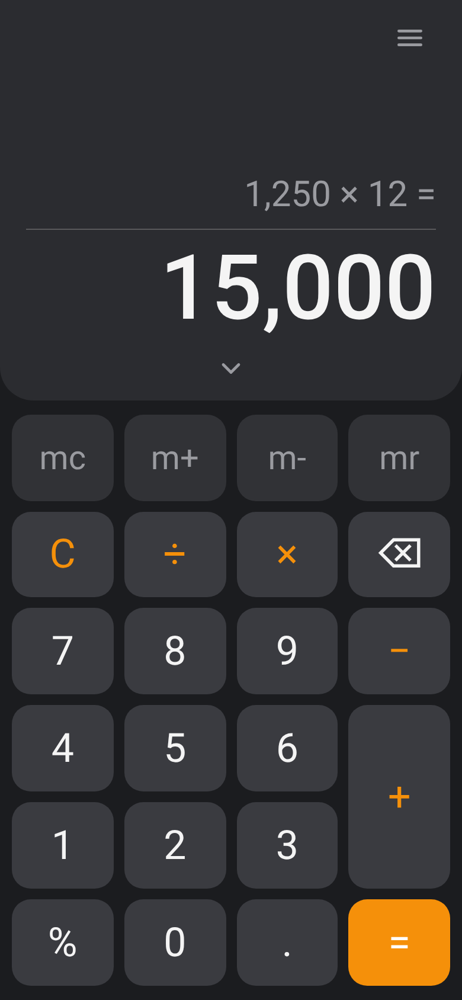
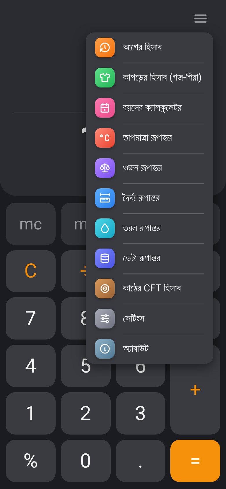
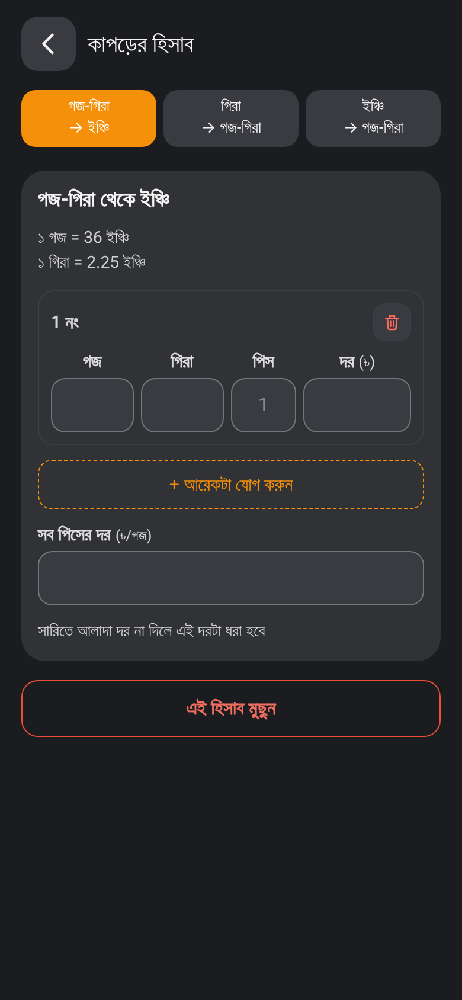
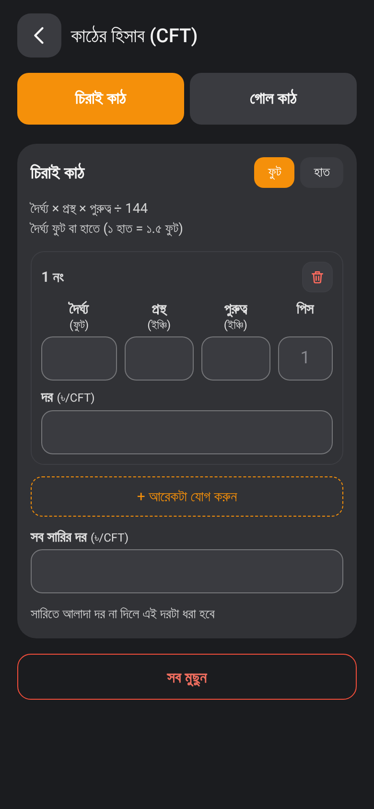

# Sohoj Calculator (সহজ ক্যালকুলেটর)

বাংলা ইন্টারফেসের একটা দ্রুত ও সহজ অ্যান্ড্রয়েড ক্যালকুলেটর। সাথে কাপড়, কাঠ, বয়স ও ইউনিট রূপান্তরের হিসাবও আছে।

## ডাউনলোড

👉 **সর্বশেষ APK:** https://github.com/MDABKP/Sohoj-Calculator/releases/latest

পাতায় গিয়ে নামের শেষে `release` লেখা APK-টা নামান। যেমন: `Sohoj-Calculator-v1.5-release.apk`

## ফিচার

**মূল ক্যালকুলেটর**
- যোগ, বিয়োগ, গুণ, ভাগ ও শতকরা
- মেমোরি বাটন (mc, m+, m-, mr)
- আগের হিসাবের ইতিহাস

**বিশেষ হিসাব**
- কাপড়ের হিসাব (গজ-গিরা ↔ ইঞ্চি)
- বয়সের ক্যালকুলেটর
- কাঠের CFT হিসাব (চিরাই ও গোল কাঠ)
- শতকরা হিসাব (শতকরা কত, বাড়া-কমার হার, মূল সংখ্যা)

**রূপান্তর**
- ওজন, দৈর্ঘ্য, তরল
- তাপমাত্রা (°C, °F, K)
- ডেটা (বাইট থেকে টেরাবাইট ইত্যাদি)

**সুবিধা**
- বাংলা ইন্টারফেস, বাংলা সংখ্যা চালু করা যায়
- একাধিক থিম: ডার্ক, লাইট, AMOLED, মিডনাইট, ক্রিম
- পছন্দের অ্যাকসেন্ট রং, শব্দ ও কম্পন নিয়ন্ত্রণ
- ফলাফল কপি ও শেয়ার করা যায়
- অ্যাপের অ্যাবাউট থেকে "আপডেট দেখুন" চাপলে নতুন ভার্সন আছে কিনা জানা যায়
- কোনো তথ্য জমা বা পাঠায় না, সব ফোনেই থাকে (শুধু আপডেট দেখুন চাপলে সর্বশেষ ভার্সন জানতে GitHub-এ যোগাযোগ করে)

## ইনস্টল করার নিয়ম

1. নামের শেষে `release` লেখা APK নামান (`debug` লেখা নয়)।
2. ফাইলে চাপ দিয়ে ইনস্টল করুন।
3. "অজানা উৎস" বা Play Protect-এর সতর্কতা এলে "তবুও ইনস্টল করুন" বেছে নিন।

**সতর্কতা কেন আসে?** অ্যাপটা Play Store-এ নেই, তাই Google এটাকে চেনে না। এটা স্বাভাবিক।

## আপডেট

একই Releases পাতা থেকে নতুন APK নামিয়ে ইনস্টল করুন, আগেরটা মুছতে হবে না।

## প্রয়োজনীয়তা

অ্যান্ড্রয়েড ৫.১ বা তার ওপরে (প্রায়)।

## সমস্যা বা পরামর্শ

GitHub-এর **Issues** ট্যাবে জানান।

## সতর্কতা

নিজের দায়িত্বে ইনস্টল করুন। শুধু এই রিপোর Releases পাতা থেকেই APK নামান।

---

ডেভেলপারদের জন্য নিজে বিল্ড করার নিয়ম: [BUILD.md](BUILD.md)
